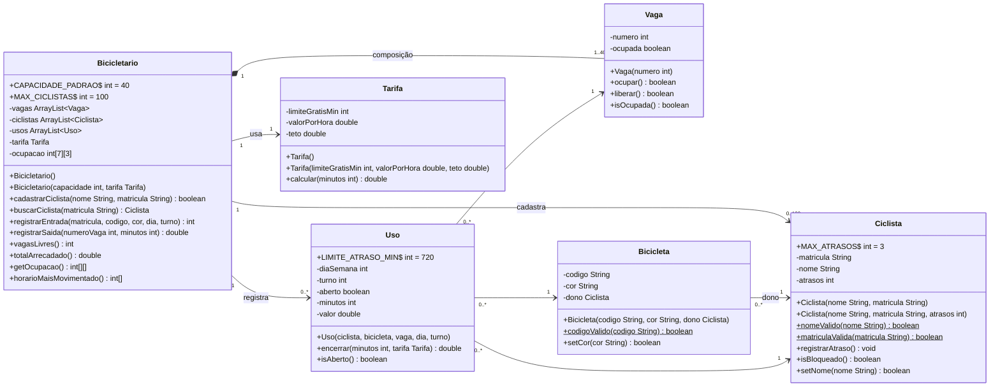

# Diagrama de Classes — Bicicletário do Campus

Notação da Aula 30: linha com seta = associação; losango cheio = composição. `-` é privado, `+` é público. O GitHub desenha o diagrama a partir do bloco Mermaid abaixo; para colar em slides, exporte em [mermaid.live](https://mermaid.live) ou redesenhe no Draw.io.

## Como ler os relacionamentos

| Relacionamento | Tipo | Pergunta do ciclo de vida (Aula 30) |
|---|---|---|
| `Bicicletario` ◆— `Vaga` | **Composição** | A vaga existe sem o bicicletário? **Não**: é criada no construtor dele |
| `Bicicleta` → `Ciclista` | Associação | O ciclista existe sem a bicicleta? **Sim** |
| `Uso` → `Ciclista`, `Bicicleta`, `Vaga` | Associação | Algum deles deixa de existir quando o uso termina? **Não** |
| `Bicicletario` → `Ciclista`, `Uso`, `Tarifa` | Associação | O bicicletário guarda referências; os objetos têm vida própria |
